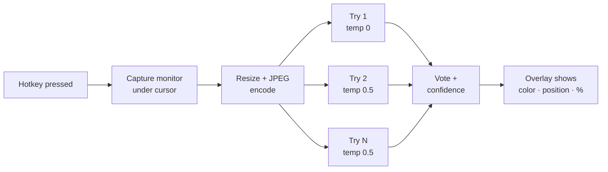

# Kahoot Answer Overlay

> **A proof of concept showing how trivially an AI vision model can answer an on-screen multiple-choice quiz in under a second.**


---

## ⚠️ Read this first

### This project is entirely AI-generated

**No part of this codebase was written by hand.** It was produced through a chain of AI tools, directed and tested by a human:

| Role | Who |
|---|---|
| Idea, direction, real-world testing, bug reports | The repository author |
| Build specification (the full prompt the code was generated from) and later debugging and features | Claude (Anthropic) |
| First complete implementation | Gemini-Argon-LLM |
| Runtime vision model used by the app | Qwen 3.8 27B, served by Groq |

Expect the rough edges that come with that: the code has been tested by running it on a real Windows machine and with the unit tests in this repository, but it has **not** had a professional security or code review. Read the code before you trust it.

### Why this exists

The author's viva is conducted on Kahoot. Multiple-choice quizzes on a screen looked like something a modern AI model could answer almost instantly, so this project was built to **demonstrate how easy that is**, and to give educators a concrete example to reason about when designing assessments.

It took a chat conversation, not expertise, to build. That is the point.

### Responsible use

This repository is published as a **demonstration and for assessment-integrity research**. It is **not** intended to be used to gain an unfair advantage in graded or proctored assessments. Doing so may breach your institution's academic-integrity policy and [Kahoot's Terms of Service](https://kahoot.com/terms-and-conditions/), and the consequences are yours alone. See [Implications for educators](#implications-for-educators) for the defensive takeaway.

---

## What it does

Press a hotkey and the app:

1. Screenshots the monitor your mouse cursor is on.
2. Sends the image to a vision model, which finds the Kahoot question anywhere on screen and picks the answer tile.
3. Shows the answer in a small overlay: **tile color and shape, on-screen position, and a confidence percentage**.

It runs from the system tray with no terminal window, and the overlay can be hidden or moved around the screen.

### Features

- **Fast:** designed around a sub-one-second hotkey-to-answer target (network, model load, and rate limits decide the real number; the overlay shows the measured milliseconds).
- **Finds the question anywhere:** no fixed screen region, works with a Kahoot window among other apps.
- **Confidence meter:** parallel "tries" vote on the answer; agreement and self-reported certainty combine into one percentage (see [How confidence works](#how-confidence-works)).
- **Adjustable tries:** use 1 try to save tokens, or up to 9 for more certainty. Change it live from the tray menu.
- **Multi-monitor aware:** captures only the monitor under the cursor.
- **Minimal overlay:** no animations, never steals keyboard focus, hidden from the taskbar, draggable, and hideable.
- **Global hotkeys** via the Win32 `RegisterHotKey` API: no admin rights, no keyboard hooks.
- **Handles more than four-tile questions:** True/False (reads the printed label instead of assuming a color), multi-select, and ordering questions.

---

## How it works



- Tries run **in parallel** and stop early once a majority agrees, so extra tries add certainty without adding much waiting time.
- Try 1 is deterministic (temperature 0). The other tries use a higher temperature, a different random seed, and a slightly different instruction. Identical requests would give identical answers and make voting meaningless.
- One persistent API connection is kept warm in the background, because a fresh TLS handshake can eat a large part of a one-second budget.

### How confidence works

Each try returns an answer and a self-reported certainty (0 to 100). The final number is:

```
confidence = average certainty of the winning tries × (winning votes ÷ finished tries)
```

It is clamped to 1–99 (never shown as 100%), and a single try is capped at 95%. The detail line on the overlay (for example `2/3 tries agree`) shows how the number was reached.

> This is a heuristic, **not** a calibrated probability. The model's self-reported certainty is itself unreliable. Treat a low number as a warning and a high number as "more likely", never as a guarantee.

---

## Requirements

- Windows 10 or 11 (64-bit)
- Python 3.11+
- A free [Groq API key](https://console.groq.com/keys)

Python packages: `groq`, `mss`, `Pillow`, `pystray` (see `requirements.txt`).

## Installation

```bash
git clone https://github.com/<your-username>/<repo-name>.git
cd <repo-name>/kahoot_overlay
pip install -r requirements.txt
```

Provide your Groq API key in **one** of two ways:

1. **Environment variable** (recommended):
   ```bash
   setx GROQ_API_KEY "your_key_here"
   ```
   Then open a new terminal. (The app also reads the saved Windows setting directly, so it works even if you launch from an older terminal.)
2. **Config file:** put it in the `"api_key"` field of `%APPDATA%\KahootOverlay\config.json`.

> 🔐 **Never commit your API key.** The config file lives in `%APPDATA%`, outside this repository, on purpose.

## Usage

```bash
pythonw main.pyw
```

`pythonw` runs it without a console window. A tray icon appears and a notification confirms it is ready.

| Action | Default hotkey |
|---|---|
| Solve (capture and answer) | `Ctrl+Alt+A` |
| Show / hide overlay | `Ctrl+Alt+H` |
| Quit | `Ctrl+Alt+Q` |

Plain `Ctrl+A` is deliberately not used because it would break Select All in every program. All hotkeys can be changed in the config file.

### The overlay

- **Move it:** click and drag anywhere on it. The position is saved per monitor.
- **Hide it:** click the **✕** in the corner, right-click anywhere on it, or press `Ctrl+Alt+H`. The next solve shows it again.
- **Tray menu → Overlay:** lock dragging, or reset the position.

### Tray menu

| Item | What it does |
|---|---|
| Solve now | Same as the hotkey |
| Show/Hide overlay | Same as the hotkey |
| Tries | 1, 2, 3, 5, 7 or 9 parallel attempts, applied immediately |
| Mode | *Fast* (answer only) or *Balanced* (short reasoning first) |
| Pipeline | *Single-stage* (one vision call) or *Two-stage* (vision reads, a text model answers) |
| Overlay | Allow dragging, Reset position |
| Open config / log file | Quick access to settings and diagnostics |
| Quit | Exit the app |

## Configuration

Settings live in `%APPDATA%\KahootOverlay\config.json`, are created on first run, and apply on the next solve without a restart. Invalid values fall back to safe defaults.

| Key | Default | Meaning |
|---|---|---|
| `model` | `qwen/qwen3.8-27b` | Groq vision model. Retired models in an old config are replaced automatically. |
| `reasoning_effort` | `none` | `none` is fastest. `low` / `medium` / `high` think longer: slower, sometimes more accurate. |
| `tries` | `3` | Parallel attempts, 1–9. |
| `tries_temperature` | `0.5` | Randomness for tries 2..N. |
| `early_exit` | `majority` | Stop waiting once most tries agree (`off` to disable). |
| `timeout_ms` | `2500` | Per-request timeout. |
| `image_max_edge` | `1568` | Longest side of the screenshot sent to the model. |
| `overlay.position` | `top-right` | A corner name, or a saved `[x, y]` offset from the monitor's corner. |
| `overlay.draggable` | `true` | Allow moving the overlay with the mouse. |
| `overlay.click_through` | `false` | Mouse clicks pass through the overlay (disables drag and ✕). |

## Command-line tools

These work without the tray or hotkeys and are useful for testing:

```bash
python main.pyw --selftest path\to\screenshot.png   # run the full pipeline on an image
python main.pyw --bench 5 path\to\screenshot.png    # latency percentiles over 5 runs
python main.pyw --list-models                       # list models your Groq account can use
python -m unittest discover -s tests                # unit tests
```

## Building a standalone `.exe`

```bash
build_exe.bat
```

Produces `dist\KahootOverlay.exe` with no console window.

## Project layout

```
kahoot_overlay/
├── main.pyw        Entry point; logs startup failures to crash.txt and shows a message box
├── app.py          Wiring, lifecycle, single-instance guard, UI queue
├── vision.py       Groq client, model discovery, prompts, parallel tries
├── voting.py       Pure voting and confidence logic (unit-tested)
├── capture.py      Screen capture, monitor detection, image encoding
├── overlay.py      The on-screen overlay (drag, hide, no animation)
├── placement.py    Pure geometry helpers for positioning
├── tray.py         System tray icon and menu
├── hotkeys.py      Global hotkeys (Win32 RegisterHotKey)
├── winutil.py      DPI awareness, single-instance mutex, window styles
├── config.py       Config loading, validation, atomic saving
└── tests/          Unit tests
```

## Troubleshooting

| Symptom | Likely cause and fix |
|---|---|
| Nothing happens on launch | Check `%APPDATA%\KahootOverlay\crash.txt` and `log.txt`. |
| "No API key found" | Set `GROQ_API_KEY` or `api_key` in the config file, then restart. |
| "Model not found" | Your Groq account no longer offers that model. Run `--list-models` and set `model`. |
| "Rate limited, using 1 tries" | You exceeded your Groq rate limit. Lower **Tries**, wait a minute, retry. Free-tier limits are tight for large image requests. |
| Wrong answers | See [Limitations](#limitations). Try `reasoning_effort: "low"` (slower) or more tries. |

## Limitations

- **Accuracy depends on the model.** A fast vision model will get some trivia wrong, especially niche, recent, or ambiguous questions, and questions whose meaning depends on an image it cannot interpret.
- **The confidence number is a heuristic**, not a statistically calibrated probability.
- **Windows only.** macOS and Linux are untested and unsupported.
- **Depends on a third-party API**, its rate limits, and the continued availability of the model. Groq has retired models before, and will again.
- **Not hardened.** It has not undergone a security review.
- **Latency varies.** The sub-second goal is a design target, not a promise.

## Implications for educators

If you run graded, un-proctored assessments through a quiz platform, assume that **anything readable on a screen can be answered by AI in about a second**, by a tool anyone can build in an afternoon. Ideas that raise the cost of this:

- Don't rely on recall-style multiple choice for high-stakes marks. Use it for practice and formative feedback.
- Pair quiz platforms with an oral or applied component where students must explain *why* an answer is right.
- Write questions that depend on in-class context, local data, or a specific scenario rather than public facts.
- Use proctoring or locked-down environments where integrity actually matters, and be clear about what they can and cannot detect.
- Shorten answer windows and randomize question order. This slows but will not stop this approach.
- Discuss AI openly with students and state which tools are and are not allowed.

## Contributing

Issues and pull requests are welcome, especially for **defensive** ideas, documentation, and bug fixes. Contributions that add stealth or detection-evasion features will not be accepted.

## Disclaimer

This software is provided "as is", without warranty of any kind. It is not affiliated with, endorsed by, or connected to Kahoot! AS, Groq, Alibaba/Qwen, Google, or Anthropic. All product names and trademarks belong to their owners. The author accepts no responsibility for how this software is used.

## License

MIT. See `LICENSE`.
