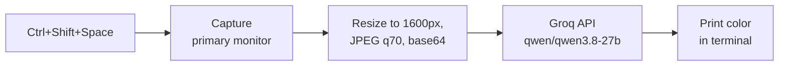

# Kahoot Sniper (Version 1)

> **The original proof of concept: a ~70-line Python script that screenshots your screen and asks an AI vision model which Kahoot answer is correct.**


-lightgrey)


> **Looking for the improved version?** This is the first, deliberately simple prototype. It has known accuracy and usability problems (listed [below](#known-issues)). **Version 2** fixes them with a background tray app, an on-screen overlay, multi-try voting and a confidence score. See [Version history](#version-history).

---

## ⚠️ Read this first

### This project is entirely AI-generated

**No part of this code was written by hand.** It was generated with an AI assistant. The repository author's role was the idea, direction and testing on a real machine.

The script is short, but it has not been professionally reviewed, and, as the [known issues](#known-issues) show, it contains mistakes that an AI assistant did not catch. Read it before you run it.

### Why this exists

The author's viva is conducted on Kahoot. Multiple-choice questions shown on a screen looked like something a modern AI model could answer almost instantly, so this script was built to **demonstrate how easy that is**. It is one file, one API call, and about a page of code.

That is the point: if a prototype this small can attempt it, educators should assume students can too.

### Responsible use

This repository is published as a **demonstration and for assessment-integrity research**. It is **not** intended to be used to gain an unfair advantage in graded or proctored assessments. Doing so may breach your institution's academic-integrity policy and [Kahoot's Terms of Service](https://kahoot.com/terms-and-conditions/), and the consequences are yours alone.

---

## What it does

1. You press a hotkey while a Kahoot question is on your screen.
2. The script captures the **primary monitor**, shrinks it, and sends it to a vision model on [Groq](https://groq.com/).
3. The model reads the question, picks an answer, and the script **prints the color** (Red, Blue, Yellow or Green) in the terminal window.



## Requirements

- Windows (the `keyboard` library also works on Linux, but this was only used on Windows)
- Python 3.9+
- A free [Groq API key](https://console.groq.com/keys)

```bash
pip install keyboard mss pillow groq
```

Use a recent `mss` release: the script calls `mss.MSS()`, which older versions do not have.

## Setup

Set your Groq API key as an environment variable, then open a **new** terminal so it picks the variable up:

```bash
setx GROQ_API_KEY "your_key_here"
```

> 🔐 **Never commit your API key** or paste it into the script.

## Usage

```bash
python kahoot.py
```

| Key | Action |
|---|---|
| `Ctrl + Shift + Space` | Capture the screen and print the answer |
| `Esc` | Quit |

The terminal window must stay open (it can be minimized behind other windows, but the script has to be running). The answer appears there:

```
============================
 ANSWER: BLUE
============================
```

## How it works

| Step | Detail |
|---|---|
| Capture | `mss` grabs monitor 1 (the primary display) |
| Compress | Image is shrunk to fit 1600x1600 and saved as JPEG at quality 70 to reduce upload time |
| Ask | One request to `qwen/qwen3.8-27b` on Groq with `temperature=0.0` and `max_tokens=10` |
| Answer | The reply is uppercased and printed |

You can tune the script by editing it directly: the model name, the prompt, the image size and the hotkey are all plain values near the top and bottom of `kahoot.py`.

## Known issues

These are the reasons version 2 exists.

| Issue | Why it matters |
|---|---|
| **Often gives wrong answers** | The model gets a single attempt with no cross-check. The whole screen is shrunk and heavily compressed, so small text can be hard to read. |
| **`max_tokens=10`** | The reply budget is tiny. If the model starts with anything other than the bare color name, the answer can be cut off or empty. |
| **Hardcoded True/False rule** | The prompt says "True is Red and False is Blue". That assumption may not match what Kahoot shows, so True/False questions can be answered backwards. The model should read the tile labels instead. |
| **Primary monitor only** | If Kahoot is on a second screen, the script captures the wrong display. |
| **Needs a terminal** | The answer is printed to a console window, which must be running and readable. |
| **No confidence score** | You cannot tell a certain answer from a guess. |
| **Comment mismatch** | A code comment says "Llama 3.2 Vision" but the model is Qwen 3.8, a sign of the code not being fully reviewed. |
| **`keyboard` library quirks** | It uses a low-level keyboard hook, which can be unreliable and may need administrator rights on some systems. |
| **Depends on a third-party model** | Groq retires models over time, so the hardcoded model name can stop working. |

## Limitations

- Accuracy depends entirely on the model and on how legible the screenshot is.
- It is a single fixed prompt with no handling for multi-select or ordering questions.
- Windows was the only tested platform.

## Version history

| Version | What it is | Highlights |
|---|---|---|
| **v1 (this)** | Single-file script | Hotkey, screenshot, one AI call, answer in the terminal |
| **v2** | Background tray app with overlay | Answer shown in a small movable on-screen overlay with no terminal, confidence percentage from parallel voting, adjustable tries, capture of the monitor the cursor is on, label-based True/False handling, global hotkeys without admin rights, model auto-discovery, unit tests |

## Implications for educators

A prototype this small can attempt a Kahoot question in seconds. If you run graded, un-proctored assessments through a quiz platform:

- Treat recall-style multiple choice as **practice and feedback**, not high-stakes evidence.
- Add an oral or applied component where students must explain *why* an answer is right.
- Write questions that depend on in-class context rather than public facts.
- Talk openly with students about which AI tools are and are not allowed.

## Disclaimer

This software is provided "as is", without warranty of any kind. It is not affiliated with, endorsed by, or connected to Kahoot! AS, Groq or Alibaba/Qwen. All product names and trademarks belong to their owners. The author accepts no responsibility for how this software is used.

## License

MIT. See `LICENSE`.
